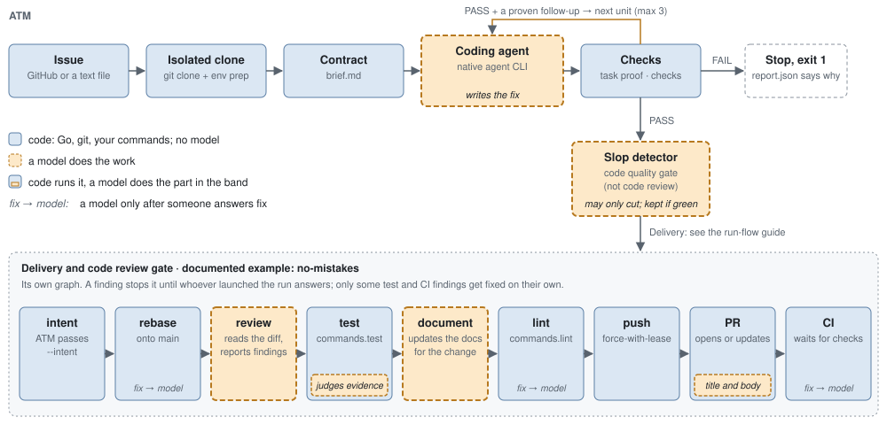

# ATM, Agentic Team Member

> The coding agent is one node. Every edge is decided by code.

[](LICENSE)

Give ATM an issue, from GitHub or a text file. It hands the issue to a coding
agent you already pay for (see [supported agents](docs/configuration.md#configatmconfigyaml)) inside an
isolated clone, with a written contract. Then code, not the agent, decides:
do the configured checks pass on the completed work? A passing run reaches
the slop detector, which may only cut.
[Delivery](docs/how-a-run-flows.md#delivery) then commits the work on its
branch and hands it to your configured command. In this repository that
command is no-mistakes, which reviews the work, opens the PR and watches CI.

<picture>
  <source media="(prefers-color-scheme: dark)" srcset="docs/assets/pipeline-dark.svg">
  
</picture>

## The screen


`atm run 634` on this repository, with the agent at work. On the left is the
graph: every step ATM's code walks and, below Delivery, the steps of the
delivery gate. On the right is the one node that is a model, live: what it
says and the tools it runs, with each failed call left in sight. The frame was
painted by ATM's own screen code from the recorded agent events of run
634-230; the elapsed time on the Agent row is illustrative.
[The screen](docs/how-a-run-flows.md#the-screen) has every box and key.

## A real run

The run in the picture, from start to end. Issue
[634](https://github.com/thellmwhisperer/agentic-team-member/issues/634) of
this repository, run 634-230 of the binary built from main at `dfefd44`,
9 November 2026, Codex with gpt-6-astra at high effort. 48 min 45 s in all,
with no question to the launcher.

| Step | Time | What happened |
|------|------|---------------|
| Issue, clone and contract | 1.5 s | the issue read from GitHub, an isolated clone of `dfefd447`, the written brief |
| Agent | 26 min 45 s | 105 commands and 4 file changes: a new end-to-end test and the fix in `internal/tui/show.go` |
| Checks | 3 min 26 s | `install`, `test`, `e2e`, `typecheck` and `lint` passed |
| Slop detector | 28.0 s | no cut kept: the cut it tried did not shorten the diff |
| Delivery | 18 min 03 s | the commit, then the delivery command, which waits for the gate below |

The delivery command of this repository starts no-mistakes, the gate:

| Gate step | Time |
|-----------|------|
| intent | 0.0 s |
| rebase | 1.3 s |
| review | 1 min 01 s |
| test | 1 min 36 s |
| document | 8.6 s |
| lint | 10.7 s |
| push | 3.8 s |
| pr | 12.5 s |
| ci | 15 min 46 s |

[PR 635](https://github.com/thellmwhisperer/agentic-team-member/pull/635) was
merged 49 minutes after `atm run 634`, with CI green, and the issue closed. It
was the second run of the issue: the first, 634-229, failed at the slop
detector.

## Who decides what

| Step | Who | Blocks on |
|------|-----|-----------|
| [Before the run](docs/how-a-run-flows.md#before-the-run) | code | an incomplete `.atm.yaml`, a base whose CI is not green, a missing worker file, a delivery command `sh` cannot find, a `compile` command that fails |
| Clone and contract | code | a failed clone or install |
| Write the fix | **model** | the model decides no edge; an agent that fails or hangs asks the launcher or ends the run, see [Agent](docs/how-a-run-flows.md#agent) |
| The project's configured `install`, `test`, `e2e`, `typecheck` and `lint` commands | code | a red `test` runs once more; a red `lint`, or a `test` still red, gives the agent one automatic turn; a failure after that asks the launcher |
| Slop detector (code quality gate, not code review) | **model**, may only cut | See [Slop detector](docs/how-a-run-flows.md#slop-detector) for file rejection and validation of the remaining cut |
| Delivery | code, then your command | a nonzero exit of the command asks the launcher; review, the PR and CI belong to the command, see [Delivery](docs/how-a-run-flows.md#delivery) |

Step by step: [How a run flows](docs/how-a-run-flows.md).

## Install

ATM runs on Linux and macOS, and on Windows through WSL.

```bash
curl -fsSL https://raw.githubusercontent.com/thellmwhisperer/agentic-team-member/main/install.sh | sh
```

It installs `atm` into `~/.local/bin`, or into `$ATM_PREFIX`. For one release,
end the line with `sh -s -- --version vX.Y.Z`.

You also need one of the [supported coding agent CLIs](docs/configuration.md#configatmconfigyaml),
and `gh` for GitHub issues.

## Run it

```bash
cd /path/to/your/repo
atm init     # writes .atm.yaml: fill in its commands and file patterns
```

Commit and push `.atm.yaml` before `atm run`; see [Configuration](docs/configuration.md#layers).

Run the repository checks, then start an issue:

```bash
atm doctor
atm run 280 --follow
```

`--follow` prints the run's events as JSON lines until it ends or awaits
the launcher's answer. Omit the flag for the terminal screen. A run can also take an issue file, such as
`plans/retry.md`.

`.atm.yaml` declares the repository's `install`, `test`, optional `e2e` and
`compile`, `typecheck` and `lint` commands, which files are tests and docs, and the
`delivery` command; `~/.config/atm/config.yaml` picks your
agent, model and effort. Both are in [Configuration](docs/configuration.md).

| Command | Does |
|---------|------|
| `atm init` | Writes a commented `.atm.yaml` and `scripts/deliver.sh`, and ignores `.atm/` |
| `atm doctor` | Checks local prerequisites; see [preflight](docs/how-a-run-flows.md#before-the-run) for launch checks |
| `atm skill`, `atm skill install` | See [ATM's driving skill](docs/configuration.md#skill) |
| `atm run [flags] <issue>` | Runs an issue: a GitHub number or a file with a title and body |
| `atm run --resume <run>` | Runs a resumable failed run's issue again from its agent's work; see [Resuming a failed run](docs/configuration.md#resuming-a-failed-run) |
| `atm answer <run> <approve\|fix\|stop> --by <who>` | Answers a failure that asks the launcher; see [Checks](docs/how-a-run-flows.md#checks) |
| `atm status` | The runs going |
| `atm attach [run]` | A run's [screen and tool-call controls](docs/how-a-run-flows.md#the-screen), including the gate after Delivery |
| `atm runs` | Every retained run and its report |
| `atm axi run`, `atm axi status`, `atm axi runs` | The same for programs, in TOON or JSON |
| `atm axi plan <plan.json>` | Shows which plan tickets can launch; see [Following a plan](docs/configuration.md#following-a-plan) |
| `atm update` | Replaces this `atm` with the latest published release |
| `atm --version` | Prints the version of this `atm` |

A run goes on in the background: leaving its screen or closing the terminal
does not stop it.

`atm run --follow`, `atm axi run`, and a screen left open until the run ends,
exit with the run's code:

| Exit | Meaning |
|------|---------|
| `0` | The run completed; Delivery passed, was skipped, or its failure was approved; see [Delivery](docs/how-a-run-flows.md#delivery) |
| `1` | Agent or Checks failed or awaits the launcher's answer; nothing is delivered yet |
| `2` | [preflight](docs/how-a-run-flows.md#before-the-run), [serve build check](docs/how-a-run-flows.md#the-screen), issue, clone, contract or slop detector failed or awaits an answer |
| `4` | Delivery failed or awaits the launcher's answer |

Off a terminal and without `--follow`, `atm run` prints the run's label and
exits 0 while the run goes on; leaving the screen with `q` also exits 0.
Interrupting `--follow` exits 1 and leaves the run going.

## Read more

- [Configuration](docs/configuration.md): both YAML files, the commands and their flags, what a run leaves on disk.
- [How a run flows](docs/how-a-run-flows.md): each step, the configured checks, the report.
- [ATM maintains itself](docs/self-maintenance.md): this repo's own fixes go through ATM; the hooks that hold the loop.
- [Contributing](CONTRIBUTING.md) · [Security](SECURITY.md) · [Code of conduct](CODE_OF_CONDUCT.md)

## License

Apache 2.0. [LICENSE](LICENSE) · [NOTICE](NOTICE)
