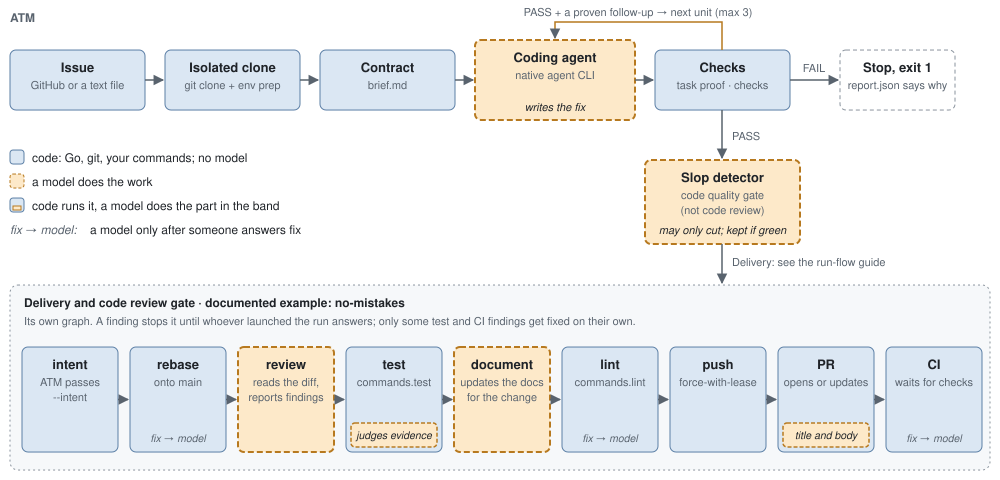

# ATM, Agentic Team Member

> The coding agent is one node. Every edge is decided by code.


[](LICENSE)

Give ATM an issue, from GitHub or a text file. It hands the issue to a coding
agent you already pay for (see [supported agents](docs/configuration.md#configatmconfigyaml)) inside an
isolated clone, with a written contract. Then code, not the agent, decides:
does the new test fail without the fix and pass with it, do the configured
checks still pass, and does the task type's proof hold. A green run reaches
the slop detector, which may only cut.
[Delivery](docs/how-a-run-flows.md#delivery) then reviews the committed work
against the issue before handing the branch to your configured command.

<picture>
  <source media="(prefers-color-scheme: dark)" srcset="docs/assets/pipeline-dark.svg">
  
</picture>

## A real run

Issue 218 of this repository, run 218-32 of the binary built from main at
`c0a1d53`, 8 October 2026, Claude Opus 5.5 at high effort from
`~/.config/atm/config.yaml`. 54 min 15 s in all: agent 11 min 16 s, 30 tool
calls; red and green verified; the slop detector kept 1 cut and re-proved it;
delivery through no-mistakes opened
[PR 244](https://github.com/thellmwhisperer/agentic-team-member/pull/244),
CI green on ubuntu, macOS and Windows, merged, issue closed. It was the second
run of the issue: the first, 218-29, failed at checks because the agent
shortened an existing test file.

The same run outside a terminal, `atm attach 218-32` piped. Its output:

```text
issue     started
issue     passed 0.3 s
clone     started
clone     passed 1.0 s
contract  started
contract  passed 0.0 s
agent     started
agent     passed 11 min 16 s
checks    started
checks    passed 8 min 20 s
ponytail  started
ponytail  passed 11 min 35 s
delivery  started
delivery  passed 22 min 59 s
issue     ✓ 0.3 s
clone     ✓ 1.0 s
contract  ✓ 0.0 s
agent     ✓ 11 min 16 s
checks    ✓ 8 min 20 s
ponytail  ✓ 11 min 35 s
delivery  ✓ 22 min 59 s
RESULT  PASS
report  .atm/runs/218-32/report.json
```

The red/green proof confirmed the fix. The slop detector kept one cut, and
every check ran again before it was kept.

## Who decides what

| Step | Who | Says no to |
|------|-----|-----------|
| Clone and contract | code | a failed clone or install, an incomplete configuration |
| Write the fix | **model** | nothing: it decides nothing |
| Red / green | code | a test that passes without the fix or fails with it |
| The project's configured `install`, `test`, `typecheck` and `lint` commands | code | any failure |
| Follow-ups | code and **model** | See [Follow-ups](docs/how-a-run-flows.md#follow-ups) for verification and scope approval |
| Slop detector (code quality gate, not code review) | **model**, may only cut | See [Slop detector](docs/how-a-run-flows.md#slop-detector) for file rejection and validation of the remaining cut |
| Delivery and code review gate | **model**, then your command | See [Delivery](docs/how-a-run-flows.md#delivery) for the review that must approve before the command runs |

Step by step: [How a run flows](docs/how-a-run-flows.md).

## Install

```bash
curl -fsSL https://raw.githubusercontent.com/thellmwhisperer/agentic-team-member/main/install.sh | sh
```

You also need one of the [supported coding agent CLIs](docs/configuration.md#configatmconfigyaml),
and `gh` for GitHub issues.

## Run it

```bash
cd /path/to/your/repo
atm init     # writes .atm.yaml: fill in its commands and file patterns
```

In the CoS session, start `atm watch` under its streaming monitor, which wakes
the session for each output line. Keep it running there. After it prints
`watching as w7k2`, start a separate command in that session:

```bash
atm doctor
atm run --watcher w7k2 280
```

Use the ID printed by `atm watch` in place of `w7k2`; a run can also take an
issue file, such as `plans/retry.md`.

`.atm.yaml` declares the repository's `install`, `test`, `typecheck` and
`lint` commands, how to run one test, which files are tests and docs, and the
`delivery` command; `~/.config/atm/config.yaml` picks your agent, model and
effort. Both are in [Configuration](docs/configuration.md).

| Command | Does |
|---------|------|
| `atm init` | Writes a commented `.atm.yaml` and ignores `.atm/` |
| `atm doctor` | Checks that a run can start, a live watcher included |
| `atm watch [--adopt <run>]` | Watches the runs bound to it until killed, one line per event; see [The watcher](docs/how-a-run-flows.md#the-watcher) |
| `atm run --watcher <id> [flags] <issue>` | Runs an issue: a GitHub number or a file with a `Type:` line. Without a live watcher it does not start |
| `atm run --resume <run>` | Runs a failed run's issue again from its agent's work, at its checks |
| `atm status` | The runs going |
| `atm attach [run]` | A run's [screen and tool-call controls](docs/how-a-run-flows.md#the-screen); completed screens stay until q or Ctrl+C |
| `atm runs` | Every retained run, its watcher and its report |
| `atm axi run`, `atm axi status`, `atm axi runs` | The same for programs, in TOON or JSON |
| `atm axi plan <plan.json>` | Shows which plan tickets can launch; see [Following a plan](docs/configuration.md#following-a-plan) |

A run goes on in the background: leaving its screen or closing the terminal
does not stop it.

For `atm run` without `--follow` and `atm axi run`; for `--follow` exit codes, see [Following one run](docs/how-a-run-flows.md#following-one-run):

| Exit | Meaning |
|------|---------|
| `0` | Every unit passed, Delivery passed or was skipped, and any observed no-mistakes gate reached merge; see [Delivery](docs/how-a-run-flows.md#delivery) |
| `1` | A unit failed; nothing is delivered |
| `2` | No live watcher; configuration, issue, clone or contract failed; or a no-mistakes gate failed or its PR closed unmerged |
| `4` | Every unit passed, but Delivery failed, including its contract review |

## Read more

- [Configuration](docs/configuration.md): both YAML files, the commands and their flags, what a run leaves on disk.
- [How a run flows](docs/how-a-run-flows.md): each step, what each task type proves, the report.
- [ATM maintains itself](docs/self-maintenance.md): this repo's own fixes go through ATM; the hooks that hold the loop.
- [Contributing](CONTRIBUTING.md) · [Security](SECURITY.md) · [Code of conduct](CODE_OF_CONDUCT.md)

## Status

Alpha. Each target repository declares its own install, test, typecheck and
lint commands in `.atm.yaml`; ATM does not detect a language's tooling. The
contract, the report and the flags can still change. Open work is in the
[issues](https://github.com/thellmwhisperer/agentic-team-member/issues).

Apache 2.0. [LICENSE](LICENSE) · [NOTICE](NOTICE)
