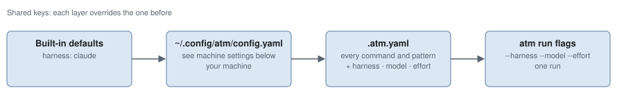

# Configuration

This page is everything you set: the two YAML files, the flags of `atm run`,
the issue it takes and the commands that go with it. What a run then does
with them is in [How a run flows](how-a-run-flows.md).

<picture>
  <source media="(prefers-color-scheme: dark)" srcset="assets/config-layers-dark.svg">
  
</picture>

## Layers

Each layer overrides the one before. A key no layer knows fails the run.

| Layer | Where | Sets |
|-------|-------|------|
| Built-in defaults | the binary | `harness: claude` |
| Your machine | `~/.config/atm/config.yaml` | `harness`, `model`, `effort` only |
| The repository | `.atm.yaml` at its root | every key below |
| One run | `atm run` flags | `--watcher`, `--base-ref`, `--harness`, `--model`, `--effort`, `--harness-arg`, `--env`, `--resume` |

## `~/.config/atm/config.yaml`

Optional. It says which agent you run everywhere.

| Key | Meaning |
|-----|---------|
| `harness` | The coding agent CLI: `claude`, `codex`, `opencode`, `pi` or `cursor` (local models go through `pi`). Any other fails the run |
| `model` | Its model; empty is the CLI's default |
| `effort` | Its effort; empty is the CLI's default |

```yaml
harness: claude
model: claude-opus-5-5
effort: high
```

### Cursor

`atm doctor` checks `cursor-agent` on PATH, not the editor's `cursor`
command. See [Agent](how-a-run-flows.md#agent) for the command ATM runs and
how it checks skill use.

Cursor has no effort flag. Leave `effort` unset in every configuration layer
and put it in a parameterized model, for example `model: 'grok[effort=high]'`.
A configured effort fails before cloning with
`cursor has no effort flag: put it in the model, as '<model>[effort=<effort>]'`.

## `.atm.yaml`

The repository declares every command a run needs. ATM detects nothing and
defaults nothing per language. Every key below is required: an empty value is
a deliberate "none", a missing key fails with `config incomplete`. `harness`,
`model` and `effort` may go here too, over your machine's file.

| Key | Meaning |
|-----|---------|
| `install` | Installs dependencies in a fresh clone |
| `test` | Runs the whole test suite |
| `typecheck` | Typechecks |
| `lint` | Lints |
| `test_file` | Runs one test: `{file}` is its path, `{dir}` its directory as `./dir`. When not empty, it must contain `{file}` or `{dir}`. For Go, `{tests}` expands to `^(TestA|TestB)$` for the Go tests defined in the reported file, for `go test -run`. A file with no Go tests fails; if the command reports `no tests to run`, the proof fails and names the reported file. |
| `test_patterns` | Globs of the test files |
| `docs_patterns` | Globs of the documentation files |
| `delivery` | Shell line that takes the run's branch from its clone, for example to a PR. Empty skips delivery |

Every command runs with `sh -c`. For a Go repository:

```yaml
install: go mod download
test: go test ./...
typecheck: go vet ./...
lint: golangci-lint run
test_file: go test -run {tests} {dir}
test_patterns: ["**/*_test.go"]
docs_patterns: ["**/*.md", "docs/**"]
delivery: 'no-mistakes axi run --intent "$ATM_INTENT"'
```

The `delivery` line hands the branch to
[no-mistakes](https://github.com/kunchenguid/no-mistakes). Without `--yes` it
only reports: whoever launched the run answers each finding.

## Commands

Run every command from inside the repository it works on.

| Command | Does |
|---------|------|
| `atm init` | Writes a commented `.atm.yaml` with every key empty, unless there is one, and adds `/.atm/` to `.gitignore` unless it is there. Run twice, it changes nothing |
| `atm doctor [--agent]` | Checks git, the configured agent CLI on `PATH`, `gh` when `origin` is on GitHub, `.atm.yaml`, and whether an `atm watch` lease is alive. One `ok` or `fail` line each; every check runs, and any failure exits non-zero. Its last line says `run atm doctor --agent to say hello to <harness>`: it makes no model call. With `--agent` it says hello instead, see [saying hello to the agent](#saying-hello-to-the-agent) |
| `atm watch [--adopt <run>]` | Watches runs bound to it until killed; see [the watcher](how-a-run-flows.md#the-watcher) |
| `atm run --watcher <id> [flags] <issue>` | Starts a run bound to a live watcher. On a terminal it keeps the completed screen open until q or Ctrl+C, then exits with the run's code; off one it prints the run's label and returns. See [the watcher](how-a-run-flows.md#the-watcher) and [resuming a failed run](#resuming-a-failed-run) |
| `atm status` | Each run going: label, step, duration, issue; or `nothing runs` |
| `atm attach [run]` | The run's screen, the last one going by default; completed screens stay until q or Ctrl+C |
| `atm runs` | Retained runs: label, `running`, `passed` or `failed at <step>`, duration, watcher, issue and report |
| `atm axi run [--json] [flags] <issue>` | Waits for the run to end, prints its outcome and exits with its code |
| `atm axi status [--json]`, `atm axi runs [--json]` | The runs going, or retained runs, as a table |
| `atm axi plan [--json] [--follow] <plan.json>` | Which tickets of a plan can launch now; see [following a plan](#following-a-plan) |

Leaving a screen with `q` or Ctrl-C, or closing the terminal, leaves the run
going. `atm axi` is for programs: it prints TOON, or JSON with `--json`. Its
outcome always carries `outcome`, `run`, `failed_node`, `reason`, `report`
(empty when the run failed before its first step) and `next_step`. Its tables
have `run`, `issue`, `step` and `duration` for `status`, and `run`, `issue`,
`outcome`, `failed_node`, `duration` and `report` for `runs`.

The exit codes are in the [README](../README.md#run-it).

### Saying hello to the agent

`atm doctor --agent` starts the configured agent (`harness`, `model`,
`effort`) with the command line a run builds, in a temporary directory it then
removes, with pipes and no terminal, and gives it one brief: `Reply with the
single word OK and nothing else.` It passes when the agent's stream ends within
2 minutes with a final message containing `OK`, read as a run reads it. For
Cursor, a result with `is_error: true` fails even after an earlier `OK` and a
zero process exit. Its last line is
`ok agent: <harness> <model> answered in <duration>`, or
`FAIL agent: <harness>: <cause>: <its last 5 lines>`, the cause an exit code,
a signal, `silent`, `timed out after 2 min 00 s`, `no OK in its final message`
or, for Cursor, the error result text.

### Following a plan

`atm axi plan <plan.json>` reads a CoS's plan, never writes it, and makes no
model call. The plan is JSON:

```json
{"version": 1, "max_active": 4, "excluded": [12],
 "tickets": [{"issue": 10, "depends_on": [9], "conflicts_with": [11],
              "hold": "waits for the PR", "hold_owner": "javi"}]}
```

A ticket counts while its issue is open and not in `excluded`. It is going
when its last run in `.atm/runs.jsonl` is `running`, or `passed` with its issue
still open (a gate or a PR not merged yet). It is ready when it has no `hold`,
every dependency is closed (`depends_on` and each `#N` under the issue's
`## Depends on` heading), it is not going, and it does not conflict with a
ticket going, named in either one's `conflicts_with`. A `hold` waits on the
CoS, or on Javi with `hold_owner: "javi"`. It prints `open`, `ready`,
`cos_holds`, `javi_holds`, `working` and `free`: `max_active` minus the runs
`running` in their `agent` step.

With `--follow` it reads again every minute and prints a JSON line when that
changes, and the same line every 30 minutes while a ready ticket has a free
slot or the CoS holds one. When no ticket is open it prints
`{"event":"plan_closed"}` and exits 0. A `gh` error goes to stderr and it tries
again. An invalid plan (no `version: 1`, no `max_active` above 0, a ticket
without `issue`) exits 2 naming the field.

## `atm run` flags

Flags go before or after the issue. A second issue is an error.

| Flag | Default | Meaning |
|------|---------|---------|
| `--base-ref <ref>` | `main` | The ref the run starts from, resolved in the repository |
| `--harness <cli>` | from the layers | `claude`, `codex`, `opencode`, `pi` or `cursor` |
| `--model <model>` | from the layers | The agent's model |
| `--effort <effort>` | from the layers | The agent's effort |
| `--harness-arg <arg>` | none | One argument for the agent CLI, before the brief. Repeatable |
| `--env KEY=VALUE` | none | One variable in the agent's environment. Repeatable |
| `--resume <run>` | none | Runs `<run>`'s issue again from its agent's work, in place of an issue |

### Resuming a failed run

A run that fails at the checks, the slop detector or the delivery keeps its
agent's work in `.atm/runs/<label>/resume/`: `resume.json` (the issue, the base
commit, the failed unit's number, its agent report and the follow-up it
chained) and `work.bundle` (the commits of the units before it, then the failed
unit's uncommitted work, new and binary files included, ignored files left
out). Its `report.json` says `"resumable": true` and names the unit in
`resumable_unit`, and its `next_step` names `atm run --resume <label>`. A run
that failed before or in the agent is not resumable.

`atm run --resume <label>` starts a new run of the same issue under its own
label. It reads the issue and `.atm.yaml` again, so a fixed config counts,
clones the saved base commit and puts the work back. The failed unit's agent
does not run again: its Agent row reads `resumed from <label>`, also as
`resumed_from` on its unit in `report.json`, and the run goes on from that
unit's checks as any run does. The other flags apply as usual, `--base-ref`
aside: the resumed run keeps the base ref of the one it resumes. A run that
does not exist, is not resumable, or whose base commit the repository no longer
has fails before cloning, saying which.

## The issue

`atm run --watcher <id> 300` reads issue 300 with `gh issue view` from the repository
`origin` names. `atm run plans/retry.md` reads a file: its first line is the
title (leading `#` characters dropped), the rest the body.

Either way the body declares its task type on a case-sensitive `Type:` line,
lowercase: `fix` (or `hotfix`), `feature`, `greenfield`, `refactor`, `tests`,
`docs` or `chore`. The type picks the proof the checks ask for; see
[How a run flows](how-a-run-flows.md#what-each-task-type-proves).

```markdown
# Retry the upload on a timeout

Type: fix

An upload that times out is lost. It should be retried once.
```

## What a run leaves on disk

Everything ATM writes lives under `.atm/` in the repository, which `atm init`
ignores.

| Path | Holds | Kept |
|------|-------|------|
| `.atm/runs/<label>/` | `report.json`, the briefs, the agent logs, `follow-ups.json`, `delivery-output.txt`, and `resume/` when the run is resumable | Always |
| `.atm/clones/atm-run-<timestamp>/` | The run's isolated clone | Removed when the run ends, unless it delivered and its PR is open |
| `.atm/runs.jsonl` | The last state of each retained run, so `atm runs` survives the background process | Every run going and the newest 200 that ended |
| `.atm/atm.sock`, `.atm/atm.lock`, `.atm/serve.log` | The background process | While it runs; the log stays |

A run's label is `<issue name>-<n>`, `n` counting the repository's runs; it is
what `atm runs` shows. A run that delivered leaves `<clone>.delivered` with its
branch and base. Each new run first removes the clones of runs that are gone,
except a delivered one whose branch is not merged into its base and whose PR
`gh` does not report closed or merged. A clone a live process still uses is
left in place.
