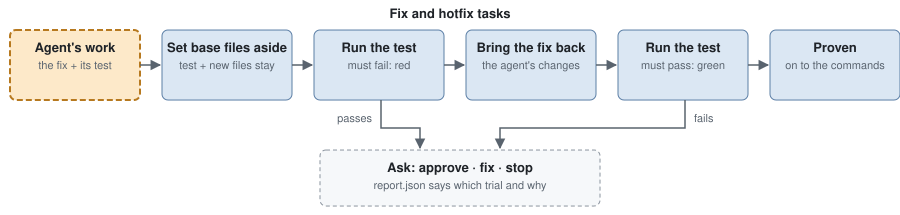

# How a run flows

This page is what `atm run` does with an issue, step by step, and what makes
each step fail. Models write the fix, cut the diff and review the commit
against the issue before delivery; code enforces the step results. What you
set before a run is in [Configuration](configuration.md).

<picture>
  <source media="(prefers-color-scheme: dark)" srcset="assets/red-green-dark.svg">
  
</picture>

## The watcher

No watcher, no run. For a watcher owned by the launch process, see
[Following one run](#following-one-run). With `--watcher`, the session starts `atm watch` first,
under its harness's streaming monitor (any tool that wakes the session on each
output line), and passes the id from its first line, `watching as <id>`, to
`atm run --watcher <id>`. It never exits on an event, so there is nothing to
re-arm.

`atm run` without `--watcher` or [`--follow`](#following-one-run), or naming a
watcher that is not alive, fails before cloning with exit code 2:
`no watcher: start atm watch in the session that launches this run and pass --watcher <id>`.
A watcher is alive while its lease, `.atm/watch/<id>.json`, names a process
that runs and a heartbeat it rewrites every 10 s is under 30 s old.
`report.json` and `atm runs` record the run's watcher, and `atm doctor` says
whether one is alive.

`atm watch` prints one line per event of each run bound to it, the time and
the run first, until it is killed:

| Line | When |
|------|------|
| `started`, then each step's name | The run, then each step, starts; `delivery` is the last |
| `gate waiting: <step>` | The no-mistakes gate waits on a decision, once per new wait |
| `still waiting 20m: <step>` | Every 10 minutes the same wait goes on |
| `gate fixing CI`, `pr <url>`, `ci green`, `merged` | The gate fixes CI, opens the PR, CI passes, the PR merges |
| `gate failed: <step>` | A gate step fails |
| `finished: passed`, `finished: failed at <step>` | The run ends |

From delivery on it reads the gate with `no-mistakes axi status` in the run's
clone every 10 s, after the run ends too, until the PR merges or the gate
fails. If Delivery fails before its command runs and no gate was seen, it stops
checking gate status and prints `finished: failed at Delivery`. If the command
ran, it keeps retrying transient status errors because a gate may have started.

When a watcher dies, each running run bound to it shows
`WATCHER GONE at <time>: no one is watching this run` once, on its screen and
in `.atm/serve.log`. `atm watch --adopt <run>` binds the run to a new watcher,
which prints its current state first, as `adopted: running at <step>`.

### Following one run

`atm run <issue> --follow` launches the run and watches it in one process, so
no separate `atm watch` is needed. `--follow` goes before or after the issue,
like any flag; a value-taking flag's value is that flag's, so
`--model --follow` is a model, not `--follow`. Before the run starts, the
process writes its own lease, `.atm/watch/<id>.json` with its PID, and binds
the run to it. It rewrites the lease every 10 s during launch and observation,
then removes it on normal exit or handled cancellation. If SIGINT or SIGTERM
arrives during launch, the process keeps refreshing the lease until launch
returns, then stops observation and removes the lease. SIGKILL leaves the
lease file behind, but its dead PID makes the watcher no longer alive.
If the lease cannot be created, no run starts.

`--follow` with `--watcher` fails before launch, since the follow process is
the run's watcher. `--follow` with `--resume` fails too: follow a resumed or
running run with `atm watch --adopt <run>`. A launch failure prints its reason
on stderr and exits 2, with no event.

Its stdout carries only JSON lines, one per event, also on a terminal; it shows
no screen and no run label. Diagnostics, such as a gate or `gh` read that
failed and is retried, go to stderr. Every line has `time` (RFC 3339, UTC),
`run`, `issue` and `event`, and these fields:

| `event` | Fields | When |
|---------|--------|------|
| `step` | `step` | A step starts |
| `delivery` | `clone` | Delivery starts, right after its `step` |
| `gate_waiting` | `step`, `clone`, `findings` (`id`, `severity`, `file`, `description` each) | The gate waits at a step for approval or a decision, once per new wait |
| `pr_opened` | `url` | The PR is first seen |
| `gate_fixing_ci` | `commit` (`sha`, `subject`, `step`) | Each PR commit whose subject starts with `no-mistakes(`, once per full `sha`, in PR order; `step` is the word inside the parentheses |
| `ci_green` | `url` | CI turns green |
| `stalled` | `minutes` | Each 60 minutes without another event; `minutes` counts since the last event other than `stalled`, so continued silence reports 60, 120, 180, ... |
| `merged` | `url` | The PR merged; the last line, exit 0 |
| `closed` | `url` | The PR closed unmerged; the last line, exit 1 |
| `run_failed` | `step`, `reason` | The run or a gate step failed; the last line, exit 1 |

For a terminal no-mistakes gate failure, including `intent` or `rebase`,
`run_failed.step` is `delivery`; other failures keep their own step, such as
`checks`. Its `reason` is the gate failure reason described under
[Delivery](#delivery). Whether the failure arrives through a status read or
the run's terminal result, available gate/PR observations and repair commit
events precede the single terminal line. A known terminal failure survives
later read errors and ends the stream even if the PR remains open.

From delivery on, polling rounds start at least 10 s apart. Each reads the
gate with `no-mistakes axi status` in the clone and, when available, the PR
with `gh`. Commit events come only from that PR read, even while the clone
is available.
If the clone is gone, it finds the PR by its known URL or the delivery's branch.
An observed gate failure takes precedence over a PR result in the same round.
The terminal events and exit codes are listed above. It also exits 1, with no
final event, when the run delivers nothing or when it is interrupted.

A CoS launches it as a background command under its streaming monitor, which
wakes the session on each line, and reads the result from the exit code.
Killing or interrupting the process stops only the following: the run goes on,
shows `WATCHER GONE` as above, and `atm watch --adopt <run>` takes it over.

## The steps

A failed step stops the run; the steps after it are not run. The exception is
a delivery command that has started a gate: see [Delivery](#delivery).

| Step | Does | Fails the run when |
|------|------|--------------------|
| Issue | Reads the issue file or GitHub issue and its `Type:` | The issue cannot be read, or has no valid type |
| Clone | Resolves `--base-ref` to a commit, clones the repository there into `.atm/clones/`, runs `install` | The ref, the clone or `install` fails |
| Contract | Writes `brief.md`, the agent's contract | The brief cannot be written |
| Agent | Runs the coding agent in the clone on the brief | It fails to complete successfully, times out, says nothing for 10 min, reaches outside its clone, does not prove use of the `ponytail` skill, or fails [report validation](#rejected-reports) |
| Checks | Prepares the clone and runs the proof and configured commands; see [Checks](#checks) | Cleanup, proof or a command fails, anything committed, or a [follow-up limit or mandatory gap](#follow-ups) blocks the run |
| Slop detector | Lets a model cut the diff; keeps the cut only if every check still passes | Its agent fails, fails [report validation](#rejected-reports), or anything commits |
| Delivery | Commits the work on a branch, has the agent review the commit against the issue, and runs the `delivery` command | The branch, the review or the command fails. Skipped when `delivery` is empty |

Agent and Checks run again for each chained follow-up, at most three units in
one run; see [Follow-ups](#follow-ups). For the gate nodes that follow
Delivery, see [Delivery](#delivery).

## Issue, clone and contract

`.atm.yaml` is read before the issue, so a bad configuration fails before
anything else. The clone is detached at the base commit, has `/.atm/` excluded,
and gets its `install` run once. Before `install`, ATM copies the repository's
`.tmp/slopslint/` into the clone at the same path, preserving file bytes and
modes so a cached executable can run without a download. No other `.tmp/`
contents are copied. If the cache is absent, cloning proceeds without creating
`.tmp/`; a copy failure stops the clone step.

The contract, `brief.md` in the run's
directory, tells the agent to read `AGENTS.md` if there is one, then gives the
issue, the acceptance criteria of its task type, the commands from
`.atm.yaml`, the style, what is forbidden and the JSON report it must end
with. It limits reading, searching and running to the clone, forbids network
access except package-manager dependency installation, and forbids access to
the surrounding repository, `.atm/runs/` and other clones.

## Agent

The native agents run in the clone in their most minimal mode.
For Hermes's ACP invocation and completion rules, see
[Hermes](configuration.md#hermes).

| Harness | Command | Reads the brief |
|---------|---------|-----------------|
| `claude` | `claude -p --setting-sources project --strict-mcp-config --thinking-display summarized`, tools `Read,Edit,Write,Bash,Glob,Grep,Skill` only; `--harness-arg`s follow this default | on stdin |
| `codex` | `codex exec`, which still loads your skills | as its last argument |
| `opencode` | `opencode run --pure`, which still loads your skills | as its last argument |
| `pi` | `pi -p --no-extensions --no-skills --no-prompt-templates --no-context-files` | as its last argument |
| `cursor` | `cursor-agent -p --output-format stream-json --trust --force --workspace <clone>`, then `--model <model>` when set and any `--harness-arg`s | as its last argument |

For `claude`, ATM sets `CLAUDE_CODE_DISABLE_BACKGROUND_TASKS=1` for every
agent call, including the slop detector and contract reviewer. It overrides
an inherited value or one passed with `--env`, so their turns wait for running
commands to finish.

For native agents, ATM writes the bundled `ponytail` skill into the clone, outside git, and the
agent's log must show it loaded under that exact name. For Codex, a
`command_execution` naming the skill's `SKILL.md` proves use only when its
`aggregated_output` contains an exact `name: <skill>` line, even if the command
exits nonzero. A trailing `\r` is ignored, so CRLF output counts. Naming the
path without that output line proves nothing, even with exit code zero.
Other native agents still require a successful load. For Cursor,
ATM installs it at `.cursor/skills/<skill>/SKILL.md` outside git; a successful
`read` or direct `cat` of that file proves use. Hermes's skill delivery and
proof are described in [Hermes](configuration.md#hermes). Every line the agent writes
goes to `worker.jsonl`, and its stderr to `worker.stderr.txt` too, as it is
written. Its report is the last JSON
object of its final message and must name `test_file`: ATM never guesses
which test proves the fix. ATM checks each logged tool call for every
harness. For write and edit tools (`write`, `edit`, `write_file` and
`edit_file`), it ignores written content (`content`, `fileText` and old/new
text fields), while checking the remaining arguments, including the destination
path. It checks all arguments for other tools. A call fails the step if it
names an absolute path
under the repository root but outside the clone, or if its shell command runs
`curl` or `wget` or contains an HTTP(S) URL whose host is not `localhost`,
`127.0.0.1` or `::1`. A read-only review call may also name its scratch
directory or a path under it. Naming any other absolute path under the
repository root but outside the clone still fails the call. One narrow
exception applies to a leading plain `cat` that writes a quoted heredoc of
valid Go test source to a literal clone-relative
`_test.go` file, followed only by a literal `go test` invocation. The heredoc
must contain a recognized test function using the standard `testing.T` type.
The exception covers URL text in that fixture only; URLs or fetch commands
elsewhere in the shell command still fail. The error names the first offending
call. Missing or invalid reports follow [Rejected reports](#rejected-reports).
For native agents, any non-zero exit
also fails; Hermes uses the completion rules linked above.
For Cursor, a stream result with `is_error: true` fails the step with its
result text even if the process exits zero.

For pi, an assistant `message_end` with `stopReason: "error"` and a nonempty
`errorMessage` fails the step with `<exit>; pi: <errorMessage>; log: <path>`,
preserving the provider's message verbatim, even with exit code zero. This
applies to every pi agent step, including the worker, slop detector and
contract reviewer, before skill-proof or report validation. A forbidden tool
call still takes precedence. A later assistant `message_end` with
`stopReason: "stop"`, `"length"` or `"toolUse"` clears the model error; the
usual skill-proof and report checks then apply. ATM does not retry a model
error or return it as a rejected report.

### Rejected reports

When final-report parsing or validation fails, ATM sends the following
message once to the same `claude`, `codex`, `pi` or `cursor` session, using
the exact validation error:

```text
Your final message was rejected: <the exact validation error>. Reply with only the JSON object the brief asks for, nothing else.
```

This applies to the worker, slop detector, contract reviewer, scope reviewer
and contract repair worker. Pi keeps its session for this continuation. If
ATM has no session ID, or the harness is OpenCode or Hermes, the report
failure ends the step without a return. A report that passes validation the
first time is never returned. If the second report validates, the step uses
it; otherwise the step fails with the second error. The report requirements
and parsing rules stay the same, and ATM does not repair the rejected report.

The agent's `.jsonl` log records a `report_rejected` event with the exact
error in `error`, even if continuation is unavailable or fails. Both
attempts' output stays in that log, and both attempts' stderr stays in its
companion `.stderr.txt` file. Process failures, timeouts, forbidden tool
calls and missing skill proof fail without returning the report.

## Checks

The agent must not have committed. ATM records the clone's paths before the
agent starts, including contents of ignored nested repositories. Before
`install` or proof, Checks removes newly made ignored files and directories,
including read-only cache trees and new contents within retained directories.
It then restores changed or deleted pre-existing ignored files from the
pre-agent snapshot, byte for byte, so package-manager state cannot claim
that removed dependencies are still installed. This includes tracked and
untracked files inside pre-existing ignored nested repositories, even when
their HEAD has not changed; restoring those files leaves their `.git` unchanged.
A repository nested inside one of those repositories is still recorded only
as a Git reference, so its file contents are not restored. Existing directory
modes remain; symlinks are removed as links, without changing their targets.
A cleanup or restoration error stops Checks before
`install` or proof. Delivery leaves the removed paths out, so a test that
needs one fails. ATM moves `.atm/` out of the clone while Checks runs,
including `install`, the proof and the other commands, then restores it even
if a check fails. This keeps follow-up tests and other `.atm/` artefacts for
ATM to process after Checks without exposing them to a check command. Checks
then run `install` again (the agent may have changed dependencies), prove the
task type, and run `test`, `typecheck` and `lint`, empty ones skipped. In
this repository `test` ends with `scripts/cover-diff.sh`, which fails naming
every changed Go line that no end-to-end run of the real `atm` binary executed;
the way out is deleting the line or writing the end-to-end test that reaches
it. The first failure stops the run with that command's last 60 lines. A
command that commits fails the checks too.

### What each task type proves

| Type | Proof |
|------|-------|
| `fix`, `hotfix` | Red/green on the files the base already has: the files the fix added stay, so the test must fail on behaviour. Then twice more, on the base with only the fix's added lines in place: a test that passes there depends on nothing the base had and is rejected |
| `feature`, `greenfield` | Red/green with everything set aside; the red may fail on a missing symbol at runtime, but not on a parse or compile error of the test file itself |
| `refactor` | `test` passes on the base, and no test file changed |
| `tests` | The new test passes on the base and after; only test and doc files changed |
| `docs` | Only files matching `docs_patterns` changed |
| `chore` | Nothing beyond the commands |

For `fix`, `feature` and `greenfield`, ATM classifies the red at the shared red/green boundary, on its whole output, before it judges the green. Recognized runner diagnostics fail with "red did not run: parse/compile error", never with "fails with the fix". For Go test files parsed before execution, a parser error gets the same classification. A red that fails on a missing symbol at runtime or on an assertion is a valid red. ATM uses each runner's output structure to distinguish diagnostics from test failures. It recognizes Go's `FAIL <package> [build failed]` or `[setup failed]` line, which a test file without a valid package clause also gets; pytest's `ERROR collecting` header and `E   SyntaxError` / `E   ImportError` lines; Jest's `● Test suite failed to run` under a `FAIL <file>` header when its `Tests` summary reports zero tests; Vitest's `Error: Failed to load url` diagnostic when its final summary reports a failed test file and no tests; node --test's `SyntaxError:` report without an assertion failure record, or its plain spec reporter error; and tsc's `<file>(<line>,<column>): error TS<n>` or `<file>:<line>:<column> - error TS<n>` diagnostic. A Jest or Vitest final summary with failed tests or a TAP test failure marked `ERR_ASSERTION` shows that an assertion ran, even if its text contains one of those markers. So a Go assertion whose own text holds `[build failed]` remains a valid red.

Red/green runs the report's `test_file` alone through `test_file` in
`.atm.yaml`, once with the fix set aside and once with it back. After each
trial ATM restores ignored files to their state before the first, including
files the trial changed or deleted, so the green cannot pass on the red's
changes. A changed tracked file voids the verdict, and a test that hangs fails
it. Known limit of the `fix` proof: where added lines cannot run alone, as in
a compiled language that needs the base's declarations, that trial fails and
the test passes it.

Every type then fails, naming the old path, when a test file the base has is
deleted or has fewer lines. A shorter file with the same line count is allowed.
If Git detects a rename, ATM checks the staged file at its new path, so moving
an unchanged or longer test is allowed.

## Follow-ups

A follow-up is a behaviour gap the agent found and did not fix. Its report
lists each as `{"title", "red_test", "criterion", "paths"}`, with the failing test
written at `.atm/follow-ups/<n>/<red_test>`. After a unit passes Checks, ATM
runs each follow-up test at `red_test` on the unit's work: it must fail. One
without its test, or whose test passes or hangs, is rejected. Code verifies
this failure.

The first accepted follow-up whose `criterion` quotes the issue is proposed
for the next unit, while a unit remains. After scope approval, it runs in the
same clone: the unit before is committed as a unit commit, the red test is
put in place, and the agent gets
`brief-unit-<n>.md` to make it pass without editing it. The checks prove that
unit red/green as a `feature`. The quote matches a whole issue line or sentence;
whitespace, list markers and a line's final punctuation are normalized.
Other follow-ups go to `follow-ups.json` in the run's directory with their
tests. Each accepted follow-up there has `"verified": true`.

Before that next unit starts, a read-only reviewer, run like the
[contract review](#delivery), compares the follow-up's `paths` plus its
red test with the issue as the run first read it: its declared scope, non-goals
and paths it reserves to another owner. Quoting a criterion widens none of
them. The CoS must declare ownership reservations in the issue; ATM does not
discover other owners. Unclear scope blocks approval. `paths` lists exact
repository-relative file paths; directories and `.` do not authorize files
below them. The red test destination is included in the review and actual-path
check. The verdict must be a single JSON object echoing exactly those paths;
each finding names a path, the issue's clause verbatim and a reason. No paths,
a missing, malformed or stale verdict, a block, or a reviewer that changes the
clone or HEAD stops the run before the worker starts: the follow-up becomes a
mandatory pending item, as below, with the review under `scope`. Once approved,
`brief-unit-<n>.md` names the approved paths. Checks compare the actual changed
paths before and after the configured commands run, including when a command
fails. Any unplanned path fails the unit and saves a blocking child draft as
for the budget below, with `cause` naming the unplanned and approved paths.
The same comparison runs on resume; a saved approval must match the current
proposal. See [resuming a failed run](configuration.md#resuming-a-failed-run)
for the saved original issue and review evidence.

The run allows at most three units. Units after the first share a fixed
200-line gross diff budget: additions plus deletions measured for each unit
against its starting commit, then accumulated. Deleting a line added by an
earlier unit counts again; net growth does not determine the budget. The
primary unit is exempt. The red test ATM placed for the additional unit is
excluded, and binary files contribute no lines. Resuming retains the earlier
units' total and measures the resumed unit again. This budget does not apply
to the slop detector's cuts.

Exceeding the budget fails Checks and saves the chained follow-up as a
blocking child draft in `follow-ups.json`: its title, criterion and red test
form the contract, `diff` holds the actual unit diff, `cause` names the total
and limit, and `dependency` names the unit's starting commit.

A quoted criterion with a verified failing test is mandatory. When no next
unit chains, including after unit three, any such pending follow-up blocks
the run with an error naming the criterion. Neither the slop detector nor
delivery runs. Every mandatory pending item retains its test and criterion,
plus the stopping unit's actual `diff`, a `cause`, and the committed stopping
unit as its `dependency`. The dependency commit is preserved in the resume
bundle. Follow-ups without a matching quote remain out of goal, however
small: they are persisted separately and do not block delivery. The CoS
creates and dispatches child issues from these drafts; workers do not.

A unit that fails before follow-up verification still hands over every
follow-up its report lists: none is run or chained, and each goes to
`follow-ups.json` with the test the
agent left, if any, and `"verified": false`. The run ends at that failure.
When `follow_ups` is invalid, the Checks failure remains the reason, with the
follow-ups problem on the next line. `atm run --resume` reads that unit's
report again, so its follow-ups appear once: unverified while Checks fail,
then verified and sorted as above if Checks pass and their red tests fail.

A unit commit is a conventional commit, so release-please sees it: its
subject is `<type>: <title>`, its body `atm unit <n>`. The type comes from the
issue's `Type:`: `fix` and `hotfix` give `fix`, `feature` and `greenfield`
`feat`, `refactor` `refactor`, `tests` `test`, `docs` `docs`, `chore` `chore`.
A chained unit, a `feature`, is a `feat`.

## Slop detector

Once every unit passed, the same agent gets `brief-ponytail.md`, the issue and
the run's diff, with the bundled `ponytail-review` skill, proven loaded the
same way. It may only cut: delete, shrink, or swap in the standard library or
an existing helper, in the diff's files, keeping every test. The required
report format is in the [ponytail brief](../internal/run/brief-ponytail.md.tmpl).

ATM snapshots the whole clone first, then judges the cut per file. It rejects
a file when a finding naming it has a missing or non-empty `issue_sentence`,
or the cut adds or deletes it, touches it as a test, or changes it outside the
run's diff. Only rejected files return to their contents before the cut;
newly added rejected files are removed. Other files' cuts stay for validation.
There is no splitting within a file. If no file survives, the whole cut is
discarded as before.

The remaining cut must report a finding and lower the run's net added lines.
ATM then checks for new files, including ignored files, and repeats every
unit's proof and the last unit's checks, preserving each unit's proven test.
If any of these requirements fails, ATM restores the whole clone byte for
byte and discards the entire cut.

A kept cut is its own commit, `ponytail: <n> cuts`, one line per surviving finding,
after the unit commit, with one slopslint tombstone per surviving finding under
`.slop/tombstones/`. Both commits use the repository's git identity; none, or
an email ending in `@localhost`, fails the run.

## Delivery

When `delivery` is set, the clone goes on a new branch
`atm/<title slug>-<timestamp>`, whatever is left uncommitted is committed as
the next unit commit, and the clone's `origin` becomes the repository's. Every
commit after the base must carry the repository's git identity.

Then the agent, with the bundled `ponytail-review` and `task-slicing` skills,
reviews read only the literal issue and the committed diff from the original
base to that HEAD. Each contract or scope review call gets its own empty
scratch directory under the run's directory, outside the clone, named in its
brief and set as its `TMPDIR`; the files its checks write go there, never
into the clone, which must not change. Both skills use the existing harness skill distribution;
proof of loading `ponytail-review` remains required. Its final message
must be a single JSON object reporting `approved` or `blocked`, with no
surrounding text; approval requires no findings, and each block quotes the
issue's criterion and its evidence in the diff.

The same report must include `task_slicing`: a disposition, reason, results
for all four [issue readiness fields](configuration.md#the-issue), pending
mandatory requirements and local child drafts. ATM validates the report's
fields, types and dispositions; it does not infer readiness from Markdown.
`unready` and `split-required` block delivery without starting a repair round.
Delivery requires both the original approval and a valid `ready` result with
no mandatory work pending. Recording a mandatory requirement in a draft or
an existing follow-up does not satisfy it.

`contract-review.json` in the run's directory keeps the issue, base, HEAD,
report and reason, including drafts outside the product branch. A split
requires a draft with its cause, parent dependency and all ten
[child contract fields](../internal/run/task-slicing/SKILL.md#local-child-contracts).
An optional improvement outside the goal can remain a local draft without
blocking fulfilled work; an unrelated change already in the diff still
blocks. ATM neither publishes nor executes these drafts, and they do not use
the worker's [follow-up format](#follow-ups).

A valid `blocked` review of a `ready` issue can start a contract repair when
a finding quotes a criterion or invariant from the original issue. ATM
matches the quote against that issue with whitespace normalized. Findings
without a matching quote never go to the repair worker; they remain for the
owner or as optional improvements according to the review's drafts.

Repairs use the existing worker harness and `ponytail` skill, one writer at a
time. The worker receives only the selected original criteria and evidence,
with instructions to make the minimal change, preserve tests, and only edit
files. If the repair agent moves HEAD, the round fails for that reason before
ATM checks files matching `test_patterns`. When HEAD is unchanged, ATM rejects
changes to or deletion of existing files matching `test_patterns` and checks
that saved proof test files retain their contents. Adding tests does not
replace the saved proofs. It re-runs every unit's task-type proof and the
configured checks through the existing checks machinery; `docs`, `chore` and
`refactor` retain their own checks without requiring a proof test file.
Failure stops delivery. A successful changed tree is committed using the
repository's Git identity, then both review skills review the current commit
again. Any repair invalidates the earlier approval. The slop detector's
cut-only policy does not apply to contract repairs, which may add lines.

There are at most two repair rounds total per run in this phase, even when
successive findings cite different criteria. There is no third attempt or
configuration to raise the limit. A report that still fails
[report validation](#rejected-reports), including one naming another base or
HEAD, a failed reviewer, or a reviewer that changes the clone or HEAD blocks
delivery without starting a repair. With no `delivery` command,
neither review, repair nor the command runs.

The `repair` record in `contract-review.json` keeps the round count, reviewed
commits and each attempt's starting commit, resulting commit when successful,
criteria, result, repeated proofs and commands. Optional drafts and unmatched
findings accumulate across rounds. A failed repair or a block remaining after
repair also records the cause and a continuation draft for the owner. These
records remain outside the product branch.

Delivery requires fresh approval of the current commit and a clean working
tree. Once approved, the command runs once with `sh -c` in the clone, without
a time limit, with these variables:

| Variable | Value |
|----------|-------|
| `ATM_TITLE` | The issue's title |
| `ATM_ISSUE` | The issue number; empty for a file |
| `ATM_ISSUE_TEXT` | The whole issue, title and body |
| `ATM_INTENT` | `ATM_ISSUE_TEXT`, then, when the slop detector committed tombstones, a `## Files ATM adds` section naming them as ATM's own record, not the issue's scope |
| `ATM_BRANCH` | The branch |
| `ATM_CLONE` | The clone's path |
| `ATM_REPORT` | The path of `report.json` |
| `ATM_PONYTAIL` | The kept cut's findings, one a line, or empty |

With no-mistakes, the line is `no-mistakes axi run --intent "$ATM_INTENT"`.
Its output goes to the screen and to `delivery-output.txt`. ATM never pushes
or opens a pull request: that is the command's business. When the configured
line contains `no-mistakes`, ATM starts reading `no-mistakes axi status` in
the clone as soon as the command starts, then every 10 s. It keeps following
the gate until the PR is merged or closed, or a gate step fails, even if the
delivery command exits nonzero while the gate is active. That command error
remains recorded; following the gate does not erase it. If the gate ends
while the command is still running, ATM stops the command and uses the gate
outcome.

When a gate step fails, the gate status's top-level `error:` line, unquoted,
supplies the run's reason when present, ahead of any earlier delivery command
error. The command error remains a separate diagnostic. The report's
`failed_node` retains the actual failed gate step.

If the gate reports `status: completed`, its `ci` step is `skipped`, and
`pr_state` is absent, ATM checks the branch's PR with `gh` even while the
clone remains. An open PR keeps the run following; a merged PR passes the
run and Delivery, leaving the CI node `skipped`. A closed, unmerged PR fails
as described below. When `pr_state` is present, the gate's result remains
authoritative. ATM does not skip CI or remove the clone to end the run.

Review, test, document, lint, push, PR and CI are nodes of the same run,
below Delivery. A closed, unmerged PR preserves the gate's recorded node
results and records `PR closed` as the run's reason; it does not turn a
completed PR node into a failed step. The [`--follow` stream](#following-one-run)
reports that outcome as `closed`.

## Time limits

| What | Limit |
|------|-------|
| Reading a GitHub issue | 60 s |
| Each checks command (`install`, `test`, `typecheck`, `lint`, a proof) | See [`check_timeout`](configuration.md#atmyaml) |
| Each agent call, the slop detector's included | See [`agent_timeout`](configuration.md) |
| An agent that writes nothing on stdout or stderr | The larger of 10 min and [`check_timeout`](configuration.md#atmyaml) |
| The delivery command | none |

Past its limit, or when the background process executing the run gets
Ctrl-C or SIGTERM, a process is killed with
every process it started, on Unix and Windows, including those that started a
session or process group of their own and, on Unix, those already orphaned.
For cancellation of `atm run --follow`, see [Following one run](#following-one-run).

## The report

`.atm/runs/<label>/report.json` is rewritten at every step's start and end, so
it is on disk before delivery reads it. Gate observations also rewrite it
when a node's state or duration changes.

| Field | Holds |
|-------|-------|
| `failed_node`, `reason` | The step that failed, if any, and the reason for failure or PR closure |
| `agent` | The effective requested `harness`, `model`, `effort` and ordered `harness_args`, after global config, `.atm.yaml` and flags. Unset model and effort stay `""`; no extra arguments is `[]` |
| `nodes` | Each step's `result` (`passed`, `failed`, `running`, `waiting`, `pending`, `skipped` or `not run`), `started_at` (UTC, RFC 3339 with milliseconds) when its start is known, and `duration_ms` when it ends; the agent node also has `exit` and `tail` when the agent ran but its step failed. Once seen, the [Delivery gate nodes](#delivery) are included with the state and duration from `no-mistakes axi status` |
| `type` | The task type |
| `units` | Each unit's number, base commit, test file, type, result, red/green proof row span, and red and green trials: command, exit code, last 60 lines, `started_at` and `duration_ms` |
| `reproofs` | The latest repeated unit proofs and spans, after a kept cut or the latest contract repair attempt; successful delivery uses the approved commit's proofs |
| `commands` | Every configured command that ran, the clone's `install` included, with its result, last 60 lines, `started_at` and `duration_ms` |
| `head_sha` | The delivered branch's final commit |
| `serve` | The version of the `atm serve` process that executed the run, from `buildinfo.String()`, for example `vA (aaa1111) 2026-10-15` |

For gate nodes, `completed` becomes `passed`, and a step awaiting a decision
becomes `waiting`. `pending`, `skipped` and `failed` keep those results;
other active states become `running`.

The Agent and `ponytail` nodes also have `agent_model`: the first model named
by that invocation's stream, or `""` when none is named. Claude and Cursor
supply the `model` in a `system` / `init` event. Pi's assistant `message_end`
supplies `message.provider` and `message.model`, recorded as
`<provider>/<model>` or just `<model>` when the provider is absent. For Codex
and OpenCode, ATM reads only an event's top-level `model` field. This value never
falls back to the requested model.
Each `units` entry keeps its own `agent_model`, so a later unit or the slop
detector cannot replace an earlier unit's attribution. A resumed unit that
does not invoke an agent has an empty observed model.

`atm runs` and `atm status`, including their `axi` forms and `--json` output,
include an `agent` column: `<harness> <model>`, or `<harness> default` when
the requested model is empty. `.atm/runs.jsonl` retains the requested
`agent` object for finished runs and after the server restarts. Old history
without attribution displays `-`; ATM does not infer it from current config.

`atm runs` and `atm axi runs`, including `--json`, show the recorded `serve`
value. `.atm/runs.jsonl` retains it after the background process exits.
Runs recorded before this field existed display `-` in these listings.

Gate nodes omit `started_at`, including skipped steps: the current
`no-mistakes axi status` step table supplies no start times. ATM does not
substitute the time it observed a step.

The `ponytail` node also records `kept` (`true` or `false`) once ATM decides
whether to keep the cut, and `reason`: the exact rejection reason from the
cut policy, new-file check or repeated proofs and checks, or `""` when kept.
`net_lines` is `[before, after]`, the run's net added lines before and after
the judged cut, measured against the run's base. When some files survive and
others are restored, `after` measures the remaining cut. `findings` preserves
the agent's findings as reported, including findings for rejected files.
Discarding the whole cut does not remove these fields or replace the judged
cut's line count with the restored count. If the step stops early, fields
whose values are not yet available are omitted.

`rejected_files` lists each file ATM put back, once, with its `path` and the
exact rejection `reason`. It is `[]` when nothing was put back, including a
cut kept in full. A partly kept cut still has `kept: true` and `reason: ""`;
its rejected files carry their individual policy reasons. If the remaining
cut also fails, files already rejected retain their reasons, and the other
files put back carry the whole-cut rejection reason. See
[Slop detector](#slop-detector) for the rejection rules.

## The screen

`atm run` hands the run to the repository's background process, one per
repository, started by the first command that needs it and ended after
10 min without a run. Closing the terminal does not stop the run.

Before sending a run, the launcher checks the connected `atm serve` process's
full build identity against its own. It reads the last PID/version pair for
that process in `.atm/serve.log`, so the check also works with older serves
and binaries installed through a symlink or under a different filename.
Matching builds accept the run as usual. A different or unverifiable build
rejects the launch with `serve <A> is older than atm <B>`; a missing version
is shown as `unknown`. This is an exact match check, not version ordering.
The rejected run is not queued, and runs already executing remain untouched.

When an idle serve detects that its executable file was replaced and closes
the connection to hand off, the launcher reconnects, starting its own serve
if needed, and checks again before sending the run. A version mismatch alone
does not stop the old serve or start a second serve alongside it. After a
rejected launch, retry once the old serve has exited and a matching serve can
take the run.

Without `--follow`, `atm run` attaches the screen on a terminal; see
[Following one run](#following-one-run) for that flag's output. The screen is
the ATM box, a row per step with its icon (`○`
pending, a spinner running, `⏸` waiting, `✓` passed, `✗` failed, `–` skipped), duration and
note, and beside it, from 100 columns, the Agent box while an agent works,
the Findings box with a failure or the slop detector's cuts, and the Log box.
The Agent box renders the agent's Markdown prose within the panel width as
`✎` lines; non-empty thinking appears as `∴` lines. By default, consecutive
successful or running tool calls are folded into one dim line below them,
with tool names and repeat counts, and each thinking message folds to one
row with its first line, cut to the panel width, until it is unfolded to its
full text. A running group has a spinner and its active tool's detail; a
failed tool keeps its own row, including the first line of its error when
available. Every row a click folds or unfolds starts with `▸` folded and
`▾` unfolded, the arrow alone underlined like a link. The box omits empty
thinking, user messages, skill text, full tool output and the JSON report
at the end of the agent's final message. Its `N tools` note counts tool
calls only.

In both `atm run` and `atm attach`, press `t` to unfold all tool groups and
press it again to fold them, and `h` to do the same for every thinking
message. Each press clears individual choices. Click a group's `N tools`
header, or a thinking message's row, to toggle just that one; clicking an
individual call does nothing. The header remains visible when unfolded.
Each unfolded call occupies one row: a state icon and word (`running`, `ok`
or `failed`), the tool name, the first line of its detail, and, after ` · `,
the first line of its result. Rows are cut to the panel width, with terminal
controls filtered out. Result summaries are read for pi, Claude, Codex,
OpenCode and Cursor. If the result is absent or its first line is blank,
the separator and summary are omitted. The footer shows `t show tool use`
or `t hide tool use`, and `h show thinking` or `h hide thinking`, beside
`q detach` while the Agent box is visible. Fold choices are not saved across
attaches.

The ATM box and the Agent box each keep every line and scroll on their own.
The mouse wheel scrolls the box under the pointer. The keys scroll the box
with the `*` marker in its title: the Agent box while it shows, the ATM box
after `Tab`. `↑` and `↓` move by a line, `PgUp` and `PgDn` by a page, and
`Home` and `End` go to the first and the last lines. A box scrolled above its
last line stays where it is as new lines come; back at its last line it follows
them again. Folding or unfolding preserves the reading position; a call
hidden by folding anchors to its group header. Stacked under 100 columns,
the ATM box takes at most two thirds of the space left after the footer and
panel gap.
On Unix, ATM keeps its screen live while the delivery command is silent. From
the command's first output until it ends, ATM gives it the attached terminal
and its keys, so no-mistakes shows its own screen there; ATM's screen comes
back when the command ends. That split stays: no-mistakes' screen is where its
decisions are made. ATM's screen shows the [Delivery gate nodes](#delivery)
as soon as they are observed, with the states and durations saved in
[the report](#the-report). Reattaching to a completed run restores those
nodes, including skipped results.
On Windows, the delivery command runs without ATM's attached terminal, so its
output appears as lines.
After a terminal run completes, the ATM screen stays open until `q` or
Ctrl+C; off-terminal output still returns when the run ends.

In a herdr pane (`HERDR_ENV=1` and
`HERDR_PANE_ID` set), the screen also shows the run in herdr's Agents section
as `atm`, with the run's label as its session: `working` with the issue, then
with each step it reaches (`#7 Agent · unit 2`, `#7 Checks · red/green`). Until
the issue title is available, `working` uses the run label. Once gate nodes
are observed, they determine activity: `working` while a gate node runs,
`blocked` while one waits for a decision and none runs. A still-running
Delivery parent does not hide that wait. The run stays listed throughout
[gate observation](#delivery) while its screen remains attached. On completion,
it reports
`idle` with `#7 passed` or `#7 failed at <step>` when the run ends. The failure
label names the failed node even if ATM never observed it running: Test
running followed by Document failed reports `#7 failed at Document`. An issue
file goes by the run's label instead of `#7`. Leaving the screen, by the run's
end or by `q`, takes `atm` out of the section. ATM runs `$HERDR_BIN_PATH` or
`herdr`, a second at most per call; a failing or missing `herdr` changes
nothing. The coding agent keeps its own herdr reporting, if it has any.

With `HERDR_ENV=1` and `herdr_workspace` set (the workspace's label; empty
opens none), `atm run --follow` owns the run's tab. It resolves the label
with `herdr workspace list`; when no open workspace has it, it creates one
with `herdr workspace create --label <label> --cwd <repo> --no-focus`, and
that workspace's root pane's tab, relabelled `atm-<issue>`, is the run's
tab. Otherwise it creates a tab in the workspace labelled `atm-<issue>`,
`--no-focus`, with the repository as cwd. Either way it runs
`atm attach <run>` in the tab's root pane. The delivery split happens there.
When `--follow` prints its last line (`merged`, `closed` or `run_failed`),
ATM closes that tab with `herdr tab close` on the id `tab create` or
`workspace create` returned, gate pane included, and only then exits. It
never closes a tab it did not create, and never closes one on a non-terminal
line. Killing the follow before that line leaves the tab; the run reports
`WATCHER GONE`. A missing `herdr`, a failed `workspace create`, `tab create`
or `tab close`, prints one line on stderr, herdr's own error included, and
changes nothing else. Without `--follow`, or with the key empty or `HERDR_ENV`
unset, no tab is opened or closed.

Off a terminal, or with `NO_COLOR` or `TERM=dumb`, the screen is plain lines:
one per step start and end, then the delivery's output and the summary. Every
duration ATM prints reads like `0.9 s`, `4 min 28 s` or `1 h 02 min`.
